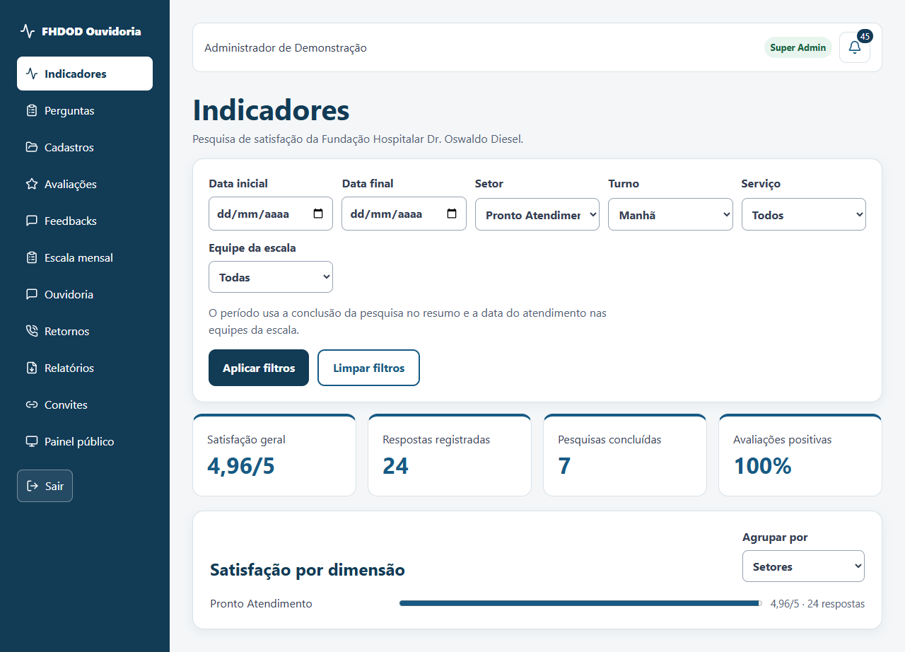

# FHOOD — Interface de experiência do paciente

Front-end da demonstração acadêmica para a Fundação Hospitalar Dr. Oswaldo Diesel. A pesquisa atende por URL e QR de setor ou convite individual. O portal reúne indicadores, escala, avaliações, manifestações, Ouvidoria, catálogos, questionários, convites, notificações e relatórios. A TV exibe agregados com limiar mínimo.

[Site publicado](https://fhdod-ouvidoria-demo.vercel.app) · [Backend de demonstração](https://github.com/ariannedemattos-aam/backend-sah) · [Swagger](https://fhdod-ouvidoria-demo.onrender.com/api-docs/)



## Arquitetura e pastas

React, Vite, React Router, TanStack Query, Axios, Socket.IO, React Hook Form, Zod, CSS e Lucide. `src/App.jsx` compõe pesquisa e rotas, `src/components/` contém interfaces públicas e internas, `src/services/` reúne chamadas à API e sessão, `src/contexts/` mantém sessão e rascunho, e `tests/` contém os testes da web. [Diagrama e infraestrutura](https://github.com/ariannedemattos-aam/backend-sah/blob/main/docs/diagramas/README.md).

A Vercel serve a SPA e encaminha autenticação de navegador ao Render. O refresh usa cookie seguro em produção e o access token fica em memória. Cinco perfis recebem menus distintos. A API confere as permissões e o setor. O paciente pode pular perguntas específicas, solicitar retorno voluntário e cancelar a navegação. Só a nota geral é obrigatória.

## Execução local

1. Configure e inicie a API e seu MySQL local. As [migrations e seeds](https://github.com/ariannedemattos-aam/backend-sah/blob/main/docs/padroes-banco-de-dados.md) pertencem ao backend.
2. Use Node.js (a entrega foi verificada com Node 24). Copie [`.env.example`](.env.example) para `.env` e preencha as URLs públicas da API e do Socket. Use a origem local esperada no CORS. As variáveis `VITE_*` são públicas e não devem conter segredos.
3. Execute:

```sh
npm ci
npm run dev
npm test
npm test -- --coverage --coverage.reporter=text-summary --coverage.reporter=json-summary
npm run build
```

A demonstração usa dados fictícios na API, com mocks da interface desabilitados. A suíte instrumentada mede 11,75% de linhas. [Cobertura e verificações em produção](https://github.com/ariannedemattos-aam/backend-sah/blob/main/docs/plano-e-relatorio-de-testes.md).

## Documentação

- [Requisitos](https://github.com/ariannedemattos-aam/backend-sah/blob/main/docs/requisitos.md), [arquitetura](https://github.com/ariannedemattos-aam/backend-sah/blob/main/docs/arquitetura-backend.md), [versionamento](https://github.com/ariannedemattos-aam/backend-sah/blob/main/docs/padroes-git.md) e [testes](https://github.com/ariannedemattos-aam/backend-sah/blob/main/docs/plano-e-relatorio-de-testes.md).
- [Modelo de dados](https://github.com/ariannedemattos-aam/backend-sah/blob/main/docs/modelo-de-dados-e-requisitos.md), [padrões de banco](https://github.com/ariannedemattos-aam/backend-sah/blob/main/docs/padroes-banco-de-dados.md), [consultas](https://github.com/ariannedemattos-aam/backend-sah/blob/main/docs/mapeamento-classes-e-consultas.md) e [segurança/nuvem](https://github.com/ariannedemattos-aam/backend-sah/blob/main/docs/seguranca-e-nuvem.md).
- [Guia visual](docs/guia-de-estilos.md), [capturas publicadas](docs/capturas/), [Swagger](https://github.com/ariannedemattos-aam/backend-sah/blob/main/docs/integration.md) e [Kanban retrospectivo no GitHub Projects](https://github.com/users/ariannedemattos-aam/projects/1/views/1).

A avaliação manual em leitor de tela e a montagem de protótipo editável ficam para revisão posterior. A demonstração permanece de uma instituição.

**Créditos** — Arianne Arruda de Mattos e Igor Gabriel Morgenstern. O histórico e o `.mailmap` documentam a autoria Git.
